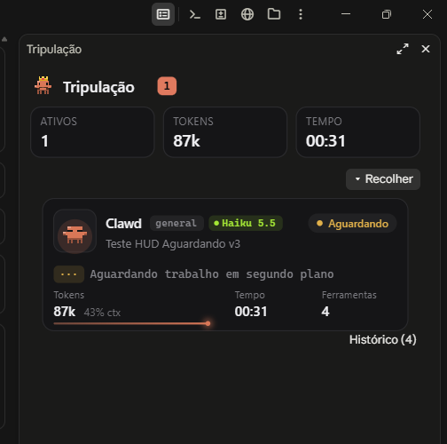
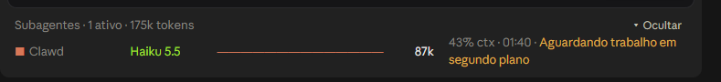

# 🦀 Tripulação

**Acompanhe cada subagente do Claude Code como um caranguejinho.**

A Tripulação é um mod para o Claude Code que mostra, em tempo real, o que cada subagente da sessão está fazendo: em qual passo está, qual modelo usa, quantos tokens já gastou, quanto do contexto ocupou e há quanto tempo está rodando.

[](LICENSE)

---

## ✨ O que você vê

**Faixa acima do prompt.** Uma linha por subagente ativo, com o caranguejo, o nome, o modelo, a barra de contexto, os tokens, a porcentagem de contexto, o tempo e a ação atual.

**Painel lateral.** Um cartão por subagente, com:

- o caranguejo do personagem dele, com as patinhas andando enquanto trabalha;
- o tipo do agente (`general`, `review`, `guide`…) e o modelo;
- um selo de status: **Trabalhando**, **Pensando**, **Aguardando**, **Concluído** ou **Erro**;
- a tarefa que recebeu e a ferramenta que está usando agora;
- métricas de tokens, contexto, tempo e número de ferramentas;
- o histórico das últimas ferramentas chamadas, que abre e fecha.

Cada subagente ganha um personagem próprio, e o tipo dele escolhe o personagem preferido: `Explore` vira a **Lupa**, `general-purpose` vira o **Clawd**, `code-review` vira o **Ninja**, e assim por diante.

### Estados

| Status | Quando aparece |
| --- | --- |
| 🟠 Trabalhando | Está executando uma ferramenta. |
| 🔵 Pensando | Aguarda a próxima resposta do modelo. |
| 🟡 Aguardando | Terminou o turno, mas segue esperando trabalho em segundo plano. Quando retoma, volta sozinho. |
| 🟢 Concluído | Devolveu o resultado. |
| 🔴 Erro | Falhou ou foi interrompido. |

---

## 🖼️ Como fica

**Painel lateral.** Um cartão por subagente, com o personagem, o status, a tarefa, as métricas e o histórico.



**Faixa acima do prompt.** Uma linha por subagente ativo, com a barra de contexto e o status.



---

## 🚀 Instalação

Você precisa do Claude Code com suporte a mods.

1. Clone o repositório numa pasta de mods:

   ```bash
   git clone https://github.com/ba-lison/tripulacao.git
   ```

2. Carregue a pasta na sessão, com `--plugin-dir`:

   ```bash
   claude --plugin-dir ./tripulacao
   ```

3. Abra o painel com o comando `/tripulacao`. Ele também se abre sozinho quando o primeiro subagente começa.

> Dica: o painel fica vazio até a primeira chamada de subagente, e isso é esperado.

---

## 🧭 Como funciona

O mod escuta os eventos do engine e guarda o estado dos subagentes na sessão:

| Evento | O que o mod faz |
| --- | --- |
| `agent.spawn` | Cria o caranguejo do subagente e abre o painel. |
| `turn.step` | Marca o subagente como "Pensando" e atualiza os tokens com o uso da resposta. |
| `tool.call` | Marca "Trabalhando", mostra a ferramenta e o alvo, e guarda no histórico. |
| `turn.complete` | Marca "Concluído", "Erro" ou "Aguardando", conforme o motivo e o status do agente. |

Um subagente em segundo plano termina o turno enquanto espera outro trabalho e retoma sob o mesmo id. Por isso o mod só dá o subagente como concluído quando ele realmente terminou, e não no primeiro turno que acaba.

---

## 🛠️ Desenvolvimento

Estrutura do repositório:

```
tripulacao/
├── .claude-plugin/plugin.json   # manifesto do mod
├── hooks/
│   ├── hooks.json               # aponta para o módulo de hooks
│   ├── register.tsx             # hooks, faixa, painel e estado
│   └── crab.ts                  # personagens e desenho dos caranguejos em SVG
├── types/index.d.ts             # contrato do estado (`$.state`)
└── tests/crew.test.ts           # testes do comportamento
```

- **Tipos.** Para o editor e o `tsc`, o engine gera a pasta `.claude-plugin/types/` quando o mod carrega. Ela não vai para o repositório, porque pertence ao engine.
- **Testes.** Rode com `claude plugin test ./tripulacao`.
- **Validação.** Com o mod carregado, `claude plugin validate ./tripulacao` confere o manifesto e o módulo.
- **Recarregamento.** Em sessão com recarregamento a quente ativo, cada edição recarrega o mod quando o turno termina.

---

## 👩‍💻 Autora

Feito por **Alison Cruz**.

## 📄 Licença

Distribuído sob a licença [MIT](LICENSE). Veja o arquivo `LICENSE` para o texto completo.
