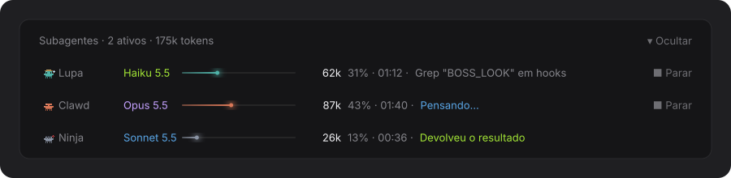
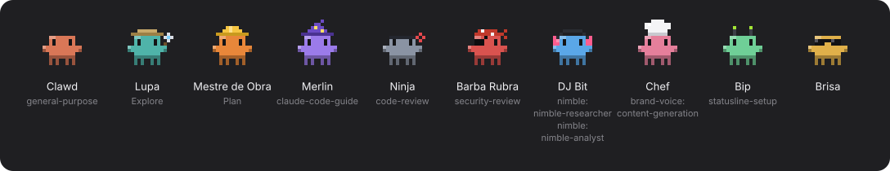

# 🦀 Tripulação

**Acompanhe cada subagente do Claude Code como um caranguejinho.**

A Tripulação é um mod para o Claude Code que mostra, em tempo real, o que cada subagente da sessão está fazendo: em qual passo está, qual modelo usa, quantos tokens já gastou, quanto do contexto ocupou e há quanto tempo está rodando.

[](LICENSE)

---

## ✨ O que você vê

### A faixa acima do prompt

<p align="center">
  
</p>

Uma linha por subagente, com:

- o caranguejo do personagem dele, o nome e o modelo;
- a barra de contexto, os tokens, a porcentagem de contexto e o tempo;
- a ferramenta e o alvo em que está mexendo agora, ou o status quando não há ferramenta;
- um botão **■ Parar** enquanto ele roda, que encerra o subagente pelo `TaskStop`.

O cabeçalho conta quantos estão ativos e soma os tokens de todos. Quem termina fica na faixa por alguns segundos e depois sai. O botão **▾ Ocultar** recolhe a faixa até a linha de resumo.

| Status | Quando aparece |
| --- | --- |
| 🟠 Trabalhando | Está executando uma ferramenta. |
| 🔵 Pensando | Aguarda a próxima resposta do modelo. |
| 🟡 Aguardando | Terminou o turno, mas segue esperando trabalho em segundo plano. Quando retoma, volta sozinho. |
| 🟢 Concluído | Devolveu o resultado. |
| 🔴 Erro | Falhou ou foi interrompido (inclusive pelo botão **■ Parar**). |

### O Rei Clawd ao lado do HUD

<p align="center">
  
</p>

No app, à esquerda do cartão do [usage-hud](https://github.com/ba-lison/usage-hud), o Rei Clawd mostra a sessão principal a partir dos mesmos eventos dos subagentes:

| Rei Clawd | Quando |
| --- | --- |
| Parado, piscando | Nada rodando: a sessão está à toa. |
| Patinhas andando no lugar, com faíscas | Uma ferramenta está rodando. |
| Olhos fechados e nuvem de pensamento | O modelo está respondendo. |
| Balão amarelo com `?` | Uma pergunta (`AskUserQuestion`) ou um plano espera sua resposta. |
| Olhos fechados, sem nuvem | O turno acabou, mas ainda há trabalho em segundo plano. |
| Olhos felizes | O turno terminou. |
| Olhos em X | O turno foi interrompido ou falhou. |

As animações são SVG que o próprio app toca: não chamam o modelo e não gastam token.

### A tripulação

<p align="center">
  
</p>

Cada subagente ganha um personagem próprio, e o tipo dele escolhe o preferido: `Explore` vira a **Lupa**, `Plan` vira o **Mestre de Obra**, `code-review` vira o **Ninja**, e assim por diante. Se o preferido já estiver ocupado, ou se o tipo não tiver um, o subagente pega um personagem livre, começando pela **Brisa**.

---

## 🚀 Instalação

Você precisa do Claude Code 2.1.275 ou mais novo. No prompt de uma sessão no terminal, rode:

```
/plugin install tripulacao --marketplace ba-lison/tripulacao
```

Responda `y` para adicionar o marketplace e escolha o escopo (o de usuário vem primeiro). O mod já fica ativo na hora.

A faixa aparece sozinha acima do prompt quando o primeiro subagente começa.

### Rodando a partir do código

Para mexer no mod, clone o repositório e carregue a pasta na sessão:

```bash
git clone https://github.com/ba-lison/tripulacao.git
```

```bash
claude --plugin-dir ./tripulacao
```

---

## 🧭 Como funciona

O mod escuta os eventos do engine e guarda o estado dos subagentes na sessão:

| Evento | O que o mod faz |
| --- | --- |
| `agent.spawn` | Cria o caranguejo do subagente na faixa. |
| `turn.step` | Marca o subagente como "Pensando" e atualiza os tokens com o uso da resposta. |
| `tool.call` | Marca "Trabalhando" e mostra a ferramenta e o alvo. |
| `turn.complete` | Marca "Concluído", "Erro" ou "Aguardando", conforme o motivo e o status do agente. |

Um subagente em segundo plano termina o turno enquanto espera outro trabalho e retoma sob o mesmo id. Por isso o mod só dá o subagente como concluído quando ele realmente terminou, e não no primeiro turno que acaba.

O mod só observa: se a contabilidade dele falhar, o subagente e a ferramenta seguem normalmente, sem bloqueio. A única ação dele é o botão **■ Parar**, que chama o `TaskStop` com o id do subagente. Se a parada falhar, um aviso explica o motivo.

---

## 🛠️ Desenvolvimento

Estrutura do repositório:

```
tripulacao/
├── .claude-plugin/
│   ├── plugin.json              # manifesto do mod
│   └── marketplace.json         # permite instalar com /plugin install
├── hooks/
│   ├── hooks.json               # aponta para o módulo de hooks
│   ├── register.tsx             # hooks, faixa e estado
│   └── crab.ts                  # personagens e desenho dos caranguejos em SVG
├── docs/
│   ├── gerar-imagens.mjs        # gera as imagens do README a partir do crab.ts
│   └── faixa.svg, rei.svg, tripulacao.svg
├── types/index.d.ts             # contrato do estado (`$.state`)
└── tests/crew.test.tsx          # testes do comportamento
```

- **Tipos.** Para o editor e o `tsc`, o engine gera a pasta `.claude-plugin/types/` quando o mod carrega. Ela não vai para o repositório, porque pertence ao engine.
- **Testes.** Rode com `claude plugin test ./tripulacao`.
- **Validação.** Com o mod carregado, `claude plugin validate ./tripulacao` confere o manifesto e o módulo.
- **Imagens do README.** São geradas a partir do próprio `crab.ts`, então os caranguejos saem idênticos aos do mod. Para regerar: `node --experimental-strip-types --no-warnings docs/gerar-imagens.mjs` (Node 22 ou mais novo). O layout da faixa é uma cópia do `register.tsx`: se ele mudar, ajuste o script também.
- **Recarregamento.** Em sessão com recarregamento a quente ativo, cada edição recarrega o mod quando o turno termina.

---

## ✅ Checklist: editar e publicar

Esta pasta é a **única fonte** do mod. O Claude Code lê direto daqui (marketplace de pasta local `tripulacao`), sem cópia no meio.

1. Edite os arquivos aqui mesmo.
2. `claude plugin validate .` e `claude plugin test .`
3. Se mudou o desenho, a faixa ou os estados, regere as imagens com `node --experimental-strip-types --no-warnings docs/gerar-imagens.mjs`.
4. Na sessão aberta, rode `/reload-plugins` ou reinicie a sessão. Não precisa subir versão nem reinstalar.
5. Confira com `claude plugin list`: `tripulacao@tripulacao` deve aparecer com `Read from:` apontando para esta pasta.
6. Para publicar: suba `version` em `.claude-plugin/plugin.json` (só quando o código muda; mudança só no README não precisa), faça o commit e o `git push`. Quem instalou pelo GitHub atualiza com `claude plugin update tripulacao@tripulacao`.
7. Confira com `git status` que não sobrou nada fora do commit e que a branch está igual à `origin/main`.

Não copie esta pasta para `~/.claude/skills` nem crie atalho/junction: o mod carregaria duas vezes ou falharia com "Path escapes plugin directory".

### Se o mod sumir ou parar de atualizar

Rode `claude plugin list`. Se `tripulacao@tripulacao` não aparecer, ou se `Read from:` apontar para `plugins/cache` em vez desta pasta, instale de novo a partir da pasta:

```bash
claude plugin marketplace add "E:\Users\aliso\Documents\.Projetos\tripulacao"
```

```bash
claude plugin install tripulacao@tripulacao --scope user
```

Depois, `/reload-plugins` na sessão aberta.

## 👩‍💻 Autora

Feito por **Alison Cruz**.

## 📄 Licença

Distribuído sob a licença [MIT](LICENSE). Veja o arquivo `LICENSE` para o texto completo.
