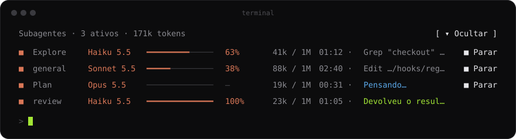

<div align="center">

# tripulação

### Veja cada subagente do Claude Code trabalhando: o que ele está fazendo, quanto da tarefa já andou, quanto contexto usou e há quanto tempo está rodando.

<p>
  
  
  
  
</p>



<br>

**🦀 Um Clawd por subagente · 📊 Progresso da tarefa · 🧠 Tokens contra a janela · ⏱️ Tempo · ■ Parar**

</div>

<br>

## Por que usar

Quando o Claude lança subagentes, eles rodam fora da sua vista. Você vê que algo começou, mas não sabe se cada um está lendo, editando, pensando ou travado, quanto da tarefa já fez nem quanto contexto está gastando.

A **tripulação** mostra isso numa faixa logo acima de onde você digita:

- Cada subagente ganha um **Clawd**, e a pose dele mostra o que o subagente está fazendo agora.
- A **barra de tarefa** acompanha a lista de tarefas do subagente, item por item.
- Os **tokens** aparecem contra a **janela de contexto real** do modelo daquele subagente.
- O botão **■ Parar** encerra um subagente sem parar a sessão.

<br>

## 🦀 A faixa, coluna por coluna

Cada subagente vira uma linha. Da esquerda para a direita:

| Coluna | Exemplo | O que mostra |
|---|---|---|
| Clawd | 🦀 | A pose do que o subagente está fazendo agora (veja as poses abaixo) |
| Tipo | `Explore` | O tipo de agente. Nomes longos encurtam: `general-purpose` vira `general`, `code-review` vira `review` |
| Modelo | `Haiku 5.5` | O modelo em que o subagente roda, no laranja do Claude |
| Barra | ━━━━🦀── | O progresso da tarefa, com um mini Clawd andando na ponta. Ele pula enquanto o subagente trabalha |
| % | `63%` | A mesma porcentagem em número, ou `—` quando o subagente não tem lista |
| Tokens | `41k / 1M` | O contexto que o subagente já ocupa, contra a janela do modelo dele |
| Tempo | `01:12` | Há quanto tempo ele está rodando. Ao terminar, o relógio para |
| Atividade | `Grep "checkout" em src` | A ferramenta e o alvo: o arquivo, o comando, o padrão ou o site |
| Parar | `■ Parar` | Encerra só aquele subagente. Some quando ele termina |

O **cabeçalho** conta quantos subagentes estão ativos e soma os tokens de todos. Quem termina fica na faixa por 6 segundos, com a última linha visível, e depois sai. A faixa só aparece quando existe pelo menos um subagente.

### Ocultar e mostrar

<div align="center">
  
</div>

O botão **▾ Ocultar**, à direita do cabeçalho, recolhe a faixa até a linha de resumo. O botão **▸ Mostrar** abre de novo. A contagem de ativos e de tokens continua aparecendo com a faixa oculta.

<br>

## 📊 Barra de tarefa

<div align="center">
  
</div>

A barra não é um chute: ela lê a **lista de tarefas que o próprio subagente mantém** e avança a cada item.

- Item **concluído** conta 1, item **em andamento** conta meio e item **pendente** conta 0.
- Com 4 itens, a barra passa por **13%, 38%, 63% e 88%** e só chega a **100%** quando o subagente responde. Até lá ela fica em no máximo 99%, porque ainda falta a resposta.
- Se o subagente não usa lista, a coluna mostra **`—`** em vez de um 0% enganoso.

A barra entende as três formas de lista que um subagente pode usar: o `update_plan` do app desktop, o `TodoWrite` e o par `TaskCreate` / `TaskUpdate`.

> [!NOTE]
> No app desktop, o próprio app recusa o `update_plan` dentro de subagentes, porque ele só mostra a lista da conversa principal. Sem isso, a barra travaria na primeira lista. Por isso a tripulação responde essa chamada nos subagentes ("Lista atualizada.") e guarda a lista na faixa. A lista da conversa principal não é tocada.

<br>

## 🧠 Tokens e janela de contexto

A coluna **Tokens** mostra o contexto do subagente depois da última resposta do modelo (entrada, cache e saída juntos), contra a janela do modelo **dele**, não da sessão:

- Se o subagente roda no **mesmo modelo** da sessão, a janela é a que o Claude Code informa.
- Num **modelo diferente**, a janela é a do modelo: **1M** para todos os modelos atuais (Haiku 5.5, Sonnet 5.5, Opus 5.5, Fable 5.1). Modelos antigos, como o Haiku 4.5, usam **200k**.
- Um modelo marcado com `[1m]` sempre conta **1M**.
- O **esforço** (low, medium, high…) não muda a janela.

Se o contexto passar da janela prevista, a coluna sobe para a próxima janela em vez de mostrar mais de 100%.

<br>

## 🎭 As poses do Clawd

<div align="center">
  
</div>

A pose vem dos eventos reais do subagente, não de uma animação aleatória:

| Pose | O que o subagente está fazendo | Evento |
|---|---|---|
| Pensando | Esperando a resposta do modelo | `turn.step` |
| Lendo | Lendo ou procurando arquivos | `tool.call`: Read, Grep, Glob |
| Editando | Mexendo em código ou arquivos | `tool.call`: Edit, Write, NotebookEdit |
| No terminal | Rodando comandos | `tool.call`: Bash, PowerShell |
| Na web | Pesquisando ou abrindo páginas | `tool.call`: WebSearch, WebFetch, navegador |
| Orquestrando | Lançou ou conversa com outros agentes | `tool.call`: Agent, SendMessage |
| Trabalhando | Usando qualquer outra ferramenta (MCP, skills…) | `tool.call` |
| Esperando você | Fez uma pergunta ou mostrou um plano | `tool.call`: AskUserQuestion, ExitPlanMode |
| Aguardando | Terminou o turno, mas espera trabalho em segundo plano | `turn.complete` com o agente `waiting` |
| Concluído | Devolveu o resultado | `turn.complete`, `reason: 'answer'` |
| Interrompido | Você apertou **■ Parar** ou Esc | `turn.complete`, `reason: 'aborted'` |
| Erro | Falhou | `turn.complete`, outro motivo |

Os Clawds dos subagentes não têm coroa: a coroa fica com o **Rei Clawd** da sessão principal, no [usage-hud](https://github.com/ba-lison/usage-hud). Os dois mods funcionam juntos, mas nenhum depende do outro.

As animações são SVG que o próprio app toca. Elas não chamam o modelo e não gastam token.

<br>

## ■ Parar um subagente

O botão **■ Parar** chama o `TaskStop` com o id daquele subagente, como o Claude faria. A linha mostra "Parando…" e, quando ele para, vira **Interrompido** em vermelho. O resto da sessão e os outros subagentes seguem normalmente. Se a parada falhar, um aviso explica o motivo.

<br>

## 💻 Funciona no app e no terminal

No **app desktop** (aba Code), cada linha tem o Clawd animado e a barra com o mini Clawd. No **terminal**, a faixa vira texto: um `■` no lugar do Clawd e a barra em traços, com as mesmas colunas e os mesmos botões.

<div align="center">
  
</div>

<br>

## Instalação

Abra o Claude Code **no terminal** (`claude`) e digite:

```
/plugin install tripulacao --marketplace ba-lison/tripulacao
```

1. Responda **`y`** para adicionar o marketplace.
2. Dê **Enter** no escopo **user**, para valer em todas as sessões.
3. **Abra uma sessão nova.** Um mod instalado no meio da sessão só aparece na próxima.

A faixa aparece sozinha quando o primeiro subagente começa.

> [!NOTE]
> O comando `/plugin install` só funciona no terminal. Na aba Code do app ele não está disponível, mas a faixa instalada pelo terminal aparece lá normalmente.

<br>

## Atualizar

```
/plugin marketplace update tripulacao
```

Depois, abra uma sessão nova.

<br>

## Perguntas frequentes

<details>
<summary><b>A barra fica em <code>—</code> o tempo todo.</b></summary>
<br>
O subagente não está usando lista de tarefas, então não há como saber quanto falta. Peça ao Claude que os subagentes mantenham uma lista (por exemplo, "use uma lista de tarefas e atualize a cada passo") e a barra passa a andar.
</details>

<details>
<summary><b>A barra parou em 99%.</b></summary>
<br>
Todos os itens da lista estão feitos, mas o subagente ainda não devolveu a resposta. Ela vai a 100% quando ele responde.
</details>

<details>
<summary><b>A tripulação deixa os subagentes mais lentos ou mais caros?</b></summary>
<br>
Não. Ela só observa os eventos e nunca bloqueia uma ferramenta: se algo falhar na contabilidade dela, o subagente segue normalmente. A única chamada que ela responde é o <code>update_plan</code> dentro de subagentes no app, que o app recusaria de qualquer jeito.
</details>

<details>
<summary><b>Preciso do usage-hud?</b></summary>
<br>
Não. Os dois mods são independentes. Com os dois instalados, a faixa da tripulação fica logo abaixo do cartão do usage-hud, com um respiro entre eles.
</details>

<br>

## Para desenvolver

| Arquivo | O que tem |
|---|---|
| `hooks/register.tsx` | Os hooks: estado dos subagentes, barra de tarefa, janela de contexto e a faixa |
| `hooks/clawd.ts` | O pixel art do Clawd, as poses, o mini Clawd e as cores |
| `types/index.d.ts` | O contrato do estado que a faixa guarda na sessão |
| `tests/crew.test.tsx` | Testes da faixa, da barra, das listas e da janela |
| `docs/gerar-imagens.mjs` | Gera as imagens deste README a partir de `hooks/clawd.ts` |
| `docs/prototipo/` | O protótipo visual e o desenho antigo dos caranguejos |

### ✅ Checklist: editar, testar e publicar

Toda mudança é testada localmente antes de ir para o GitHub.

1. Edite os arquivos nesta pasta.
2. Valide e teste:

   ```bash
   claude plugin validate .
   ```

   ```bash
   claude plugin test .
   ```

3. Se mudou o visual, gere as imagens do README de novo:

   ```bash
   node docs/gerar-imagens.mjs
   ```

4. Suba `version` em `.claude-plugin/plugin.json` e instale a partir desta pasta para testar de verdade:

   ```bash
   claude plugin marketplace update tripulacao
   ```

   ```bash
   claude plugin update tripulacao@tripulacao
   ```

   Na sessão aberta, rode `/reload-plugins`, ou abra uma sessão nova, e confira.

5. Funcionou? Faça o commit e o `git push`.
6. Confira com `git status` que não sobrou nada fora do commit e que a branch está igual à `origin/main`.

Não copie esta pasta para `~/.claude/skills` nem crie atalho ou junction: o mod carregaria duas vezes ou falharia com "Path escapes plugin directory".

<br>

## Licença

[MIT](LICENSE) © Alison Cruz

<br>

<div align="center">
<sub>Feito por <a href="https://github.com/ba-lison">Alison Cruz</a></sub>
</div>
